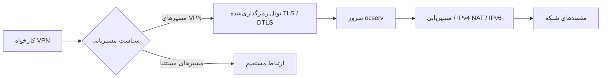

<div align="center" dir="rtl" lang="fa-IR">

<a href="https://github.com/sfc9982/AnyConnect-Server"></a>

<h1>AnyConnect-Server</h1>

<p><strong>راه‌اندازی و مدیریت یک سرور SSL VPN شخصی روی لینوکس، با نصب آسان و آزمون‌های قابل بازتولید.</strong></p>
<p>مبتنی بر <a href="https://www.infradead.org/ocserv/">ocserv</a> · سازگار با پروتکل AnyConnect · ارتباط TLS / DTLS · احراز هویت با گواهی و گذرواژه</p>

<p>
<a href="https://github.com/sfc9982/AnyConnect-Server/blob/main/LICENSE"></a>


</p>

<p>
<a href="#quick-start-fa">نصب سریع</a> ·
<a href="#ci-status">وضعیت CI</a> ·
<a href="#supported-systems-fa">سیستم‌های پشتیبانی‌شده</a> ·
<a href="#security-fa">امنیت</a>
</p>

<p><a href="README.md">English</a> · <a href="README.zh-CN.md">简体中文</a> · <strong>فارسی (ایران)</strong></p>

</div>

> [!NOTE]
> این پروژه از پیاده‌سازی متن‌باز <code>ocserv</code> برای پروتکل AnyConnect استفاده می‌کند و وابسته به Cisco نیست و تأیید رسمی آن شرکت را ندارد. آزمون‌های اتصال خودکار با OpenConnect انجام می‌شوند؛ سازگاری ممکن است بسته به نسخهٔ کلاینت Cisco متفاوت باشد.

<h2 id="features-fa" dir="rtl" align="right">ویژگی‌های اصلی</h2>

<table dir="rtl">
<tr>
<td width="50%" valign="top"><strong>نصب با یک فرمان</strong><p>شناسایی توزیع لینوکس، کامپایل ocserv، ساخت گواهی، پیکربندی فایروال و راه‌اندازی سرویس.</p></td>
<td width="50%" valign="top"><strong>مدیریت چرخهٔ عمر حساب‌ها</strong><p>گواهی مستقل PKCS#12 برای هر کاربر؛ ایجاد، تعلیق، فعال‌سازی مجدد و لغو دائمی دسترسی.</p></td>
</tr>
<tr>
<td width="50%" valign="top"><strong>تونل TLS و DTLS</strong><p>انتقال رمزگذاری‌شده، مسیریابی تفکیکی پیش‌فرض و امکان فعال‌سازی IPv6 با مسیر بازگشت مناسب.</p></td>
<td width="50%" valign="top"><strong>آزمون‌های یکپارچهٔ واقعی</strong><p>ماتریس توزیع‌های لینوکس، سناریوهای IPv6 و فایروال، آزمون بار و بازراه‌اندازی ماشین مجازی systemd.</p></td>
</tr>
</table>

<h2 id="requirements-fa" dir="rtl" align="right">پیش‌نیازها</h2>

<table dir="rtl">
<tr><th align="right">مورد</th><th align="right">نیازمندی</th></tr>
<tr><td>سرور</td><td>یک VPS با IP عمومی اختصاصی؛ ترجیحاً مجازی‌سازی کامل مانند KVM یا Xen</td></tr>
<tr><td>سیستم‌عامل</td><td>یکی از توزیع‌های لینوکسی بخش بعد؛ استفاده از systemd برای اجرای خودکار سرویس پس از بوت</td></tr>
<tr><td>رابط مجازی</td><td>دسترسی به <code>/dev/net/tun</code> و فعال بودن TUN/TAP</td></tr>
<tr><td>دسترسی مدیریتی</td><td>کاربر <code>root</code> یا دسترسی <code>sudo</code></td></tr>
<tr><td>دامنه</td><td>اختیاری؛ امکان اتصال با IP نیز وجود دارد، اما دامنه می‌تواند مدیریت گواهی را آسان‌تر کند.</td></tr>
</table>

<h2 id="supported-systems-fa" dir="rtl" align="right">سیستم‌های پشتیبانی‌شده</h2>

<table dir="rtl">
<tr><th align="right">توزیع</th><th align="right">نسخه‌ها</th><th align="right">مدیر بسته</th></tr>
<tr><td>Debian</td><td>11 / 12</td><td><code>apt</code></td></tr>
<tr><td>Ubuntu</td><td>20.04 / 22.04 / 24.04</td><td><code>apt</code></td></tr>
<tr><td>RHEL / CentOS / Rocky / AlmaLinux / OpenEuler و مشابه آن‌ها</td><td>8 / 9 و بالاتر</td><td><code>dnf</code> / <code>yum</code> (با وابستگی به EPEL)</td></tr>
<tr><td>Fedora</td><td>38 و بالاتر</td><td><code>dnf</code></td></tr>
<tr><td>Arch Linux / Manjaro</td><td>انتشار غلتان</td><td><code>pacman</code></td></tr>
<tr><td>openSUSE Leap</td><td>15</td><td><code>zypper</code></td></tr>
</table>

<p dir="rtl" align="right">نبود systemd ممکن است راه‌اندازی خودکار پس از بوت را غیرممکن کند. نسخه‌هایی که صریحاً در CI آزمایش می‌شوند عبارت‌اند از Ubuntu 22.04/24.04، Debian 11/12، Fedora 40، Rocky 9، AlmaLinux 9، Arch Linux و openSUSE Leap. همهٔ نسخه‌های جدول بالا به‌طور یکسان آزموده نشده‌اند.</p>

<h2 id="quick-start-fa" dir="rtl" align="right">نصب سریع</h2>

<p dir="rtl" align="right">روی یک VPS تحت مدیریت خودتان که از TUN/TAP پشتیبانی می‌کند، وارد شوید. مدت کامپایل به قدرت پردازنده و سرعت شبکه بستگی دارد. در حال حاضر دو اسکریپت مدیریتی انگلیسی و چینی وجود دارد؛ <strong>نسخهٔ فارسی README به معنی وجود نصب‌کنندهٔ فارسی نیست.</strong> برای نصب با منوهای انگلیسی:</p>

```bash
# Connect to your Linux VPS, then become root.
sudo su

# Download and run the English installer.
wget -N https://raw.githubusercontent.com/sfc9982/AnyConnect-Server/main/ocserv-en.sh
chmod +x ocserv-en.sh
bash ocserv-en.sh
```

<p dir="rtl" align="right">در منوی اولیه گزینهٔ <code>1</code> را برای نصب انتخاب کنید. نصب‌کننده اطلاعات زیر را درخواست می‌کند:</p>

<table dir="rtl">
<tr><th align="right">گزینه</th><th align="right">توضیح</th><th align="right">پیشنهاد</th></tr>
<tr><td>نام کاربری VPN</td><td>حساب اولیه؛ مقدار پیش‌فرض <code>admin</code></td><td>یک نام مناسب و غیرقابل‌حدس انتخاب کنید.</td></tr>
<tr><td>گذرواژهٔ VPN</td><td>الزامی؛ هنگام ورود نمایش داده نمی‌شود.</td><td>گذرواژه‌ای قوی؛ این مقدار برای رمز فایل <code>.p12</code> نیز به کار می‌رود.</td></tr>
<tr><td>درگاه TCP</td><td>مقدار پیش‌فرض <code>443</code></td><td>در صورت امکان همان درگاه پیش‌فرض را نگه دارید.</td></tr>
<tr><td>درگاه UDP</td><td>به‌طور پیش‌فرض مانند TCP است.</td><td>برای عملکرد DTLS درگاه UDP را نیز باز کنید.</td></tr>
</table>

<p dir="rtl" align="right">پس از نصب، نشانی سرور نمایش داده می‌شود؛ برای مثال <code>123.45.67.89:443</code>.</p>

> [!TIP]
> پیش از اجرای اسکریپت با دسترسی <code>root</code>، محتوای آن را بررسی کنید. در فایروال سیستم‌عامل و همچنین گروه امنیتی / فایروال ارائه‌دهندهٔ VPS، ترافیک ورودی TCP و UDP روی درگاه انتخاب‌شده را مجاز کنید.

<!-- ci-status:start -->

<h2 id="ci-status" dir="rtl" align="right">وضعیت آزمون‌های CI</h2>

<p dir="rtl" align="right">این نشان‌ها وضعیت آخرین اجرای ناشی از <code>push</code> روی شاخهٔ <code>main</code> را نشان می‌دهند. برای دیدن جزئیات روی هر نشان کلیک کنید.</p>

<table dir="rtl">
  <tr>
    <td width="50%" align="center">
      <p><strong>کیفیت کد</strong><br><sub>ShellCheck · بررسی نحو Bash و Python</sub></p>
      <a href="https://github.com/sfc9982/AnyConnect-Server/actions/workflows/lint.yml?query=branch%3Amain+event%3Apush">
        
      </a>
    </td>
    <td width="50%" align="center">
      <p><strong>آزمون‌های بازگشتی نصب‌کننده</strong><br><sub>بازیابی پس از خطا · نسخهٔ دقیق کد آزموده‌شده</sub></p>
      <a href="https://github.com/sfc9982/AnyConnect-Server/actions/workflows/vpn-source.yml?query=branch%3Amain+event%3Apush">
        
      </a>
    </td>
  </tr>
  <tr>
    <td width="50%" align="center">
      <p><strong>آزمون‌های اولیهٔ توزیع‌ها</strong><br><sub>۹ توزیع لینوکس · هر دو نصب‌کننده</sub></p>
      <a href="https://github.com/sfc9982/AnyConnect-Server/actions/workflows/distro-test.yml?query=branch%3Amain+event%3Apush">
        
      </a>
    </td>
    <td width="50%" align="center">
      <p><strong>آزمون سرتاسری واقعی VPN</strong><br><sub>TLS / DTLS · DNS / NAT · چرخهٔ عمر حساب</sub></p>
      <a href="https://github.com/sfc9982/AnyConnect-Server/actions/workflows/vpn-e2e.yml?query=branch%3Amain+event%3Apush">
        
      </a>
    </td>
  </tr>
  <tr>
    <td width="50%" align="center">
      <p><strong>IPv6 بومی و راه‌اندازی سیستم</strong><br><sub>مسیریابی IPv6 · راه‌اندازی مجدد Ubuntu 22.04</sub></p>
      <a href="https://github.com/sfc9982/AnyConnect-Server/actions/workflows/vpn-native.yml?query=branch%3Amain+event%3Apush">
        
      </a>
    </td>
    <td width="50%" align="center">
      <p><strong>اعتبارسنجی پیشرفتهٔ VPN</strong><br><sub>ترافیک دوپشته · فایروال مرزی · راه‌اندازی مجدد Ubuntu 24.04</sub></p>
      <a href="https://github.com/sfc9982/AnyConnect-Server/actions/workflows/vpn-production.yml?query=branch%3Amain+event%3Apush">
        
      </a>
    </td>
  </tr>
</table>

<details dir="rtl">
<summary>اعتبارسنجی زمان‌بندی‌شده و دستی</summary>

<table dir="rtl">
  <tr>
    <td width="50%" align="center">
      <p><strong>آزمون فشار زمان‌بندی‌شده</strong><br><sub>۲۰ کارخواه · ۳۰ دقیقه؛ یکشنبه‌ها ۲ ساعت</sub></p>
      <a href="https://github.com/sfc9982/AnyConnect-Server/actions/workflows/vpn-production.yml?query=branch%3Amain+event%3Aschedule">
        
      </a>
    </td>
    <td width="50%" align="center">
      <p><strong>آزمون بیرونی VPS</strong><br><sub>اجازهٔ دستی · میزبان آزمایشی متعلق به شما</sub></p>
      <a href="https://github.com/sfc9982/AnyConnect-Server/actions/workflows/vpn-vps.yml?query=branch%3Amain+event%3Aworkflow_dispatch">
        
      </a>
    </td>
  </tr>
</table>

<p dir="rtl" align="right">نشان‌های اجرای زمان‌بندی‌شده و دستی مستقل از آزمون‌های معمول هستند. سبز بودن CI عادی به‌معنای اجرای آزمون فشار طولانی یا آزمون VPS نیست؛ «اجرانشده» و «ردشده (skipped)» را نباید موفقیت دانست. دامنه و مدت واقعی را در نتیجهٔ کار و فایل‌های خروجی بررسی کنید.</p>

</details>

[همهٔ اجراهای GitHub Actions](https://github.com/sfc9982/AnyConnect-Server/actions?query=branch%3Amain) · [پوشش آزمون‌های اصلی](tests/README.md) · [آزمون‌های پیشرفته و محدودیت‌ها](tests/EXTENDED-TESTS.md)

<!-- ci-status:end -->

<h2 id="architecture-fa" dir="rtl" align="right">نحوهٔ عبور ترافیک</h2>



<p dir="rtl" align="right">مقصدهای مشمول VPN از تونل عبور می‌کنند و مسیرهای مستثنا روی شبکهٔ محلی می‌مانند. <strong>نکتهٔ مهم برای کاربران ایران:</strong> قواعد تفکیک مسیر پیش‌فرض این پروژه برای آدرس‌های داخلی چین تنظیم شده‌اند؛ این قواعد به‌معنای تفکیک خودکار آدرس‌های ایران نیستند و باید متناسب با نیاز خود بررسی و ویرایش شوند. IPv6 نیز اختیاری است و به پیشوند آدرس مناسب و مسیر بازگشت در شبکهٔ بالادستی نیاز دارد؛ نصب‌کننده NAT66 یا واگذاری خودکار پیشوند عمومی IPv6 انجام نمی‌دهد.</p>

<h2 id="installation-fa" dir="rtl" align="right">نصب‌کننده چه کارهایی انجام می‌دهد؟</h2>

<ol dir="rtl">
<li>شناسایی توزیع لینوکس و بررسی قابلیت TUN/TAP.</li>
<li>نصب پیش‌نیازهای ساخت مانند GnuTLS، libev، seccomp، libnl، به‌همراه iptables و OpenSSL.</li>
<li>دریافت کد منبع رسمی <code>ocserv 1.5.0</code> و کامپایل با Meson و Ninja.</li>
<li>ساخت CA خصوصی و گواهی سرور متناسب با IP یا نام سرور.</li>
<li>ایجاد فهرست ابطال گواهی (CRL) و فعال‌سازی احراز هویت گواهی با امکان ورود از راه گذرواژه.</li>
<li>ساخت اولین حساب کاربری، همراه با گواهی و گذرواژه.</li>
<li>فعال‌سازی انتقال بسته‌های IPv4، تنظیم NAT و درگاه‌های سرویس و ذخیرهٔ قواعد فایروال برای بوت.</li>
<li>راه‌اندازی سرویس و بررسی وضعیت آن. اگر مرحله‌ای ضروری شکست بخورد، نصب با خطا متوقف می‌شود.</li>
</ol>

<h2 id="connect-fa" dir="rtl" align="right">اتصال از دستگاه کاربر</h2>

<p dir="rtl" align="right">برای هر کاربر، یک بستهٔ گواهی <code>.p12</code> در مسیر زیر تولید می‌شود. فایل را فقط از راهی امن به دستگاه موردنظر منتقل کنید:</p>

```text
/etc/ocserv/ssl/users/<username>/<username>.p12
```

<h3 dir="rtl" align="right">۱. وارد کردن گواهی کاربر</h3>

<p dir="rtl" align="right">گذرواژهٔ ورود به بستهٔ گواهی معمولاً همان گذرواژهٔ VPN آن کاربر است.</p>

<ul dir="rtl">
<li><strong>Windows:</strong> فایل <code>.p12</code> را باز کنید، ذخیره‌سازی برای کاربر فعلی (Current User) را انتخاب کرده و رمز بسته را وارد کنید.</li>
<li><strong>macOS:</strong> فایل را در Keychain Access، معمولاً در دستهٔ «login»، وارد و وجود هویت گواهی را بررسی کنید.</li>
<li><strong>Android:</strong> از بخش Settings → Security → Encryption &amp; credentials → Install from storage استفاده کنید. نام منو در گوشی‌های مختلف متفاوت است.</li>
<li><strong>iOS / iPadOS:</strong> فایل را با AirDrop یا Files منتقل و طبق مراحل نصب پروفایل در Settings → General → VPN &amp; Device Management وارد کنید. اگر لازم است CA خصوصی سرور را نیز معتبر کنید، آن گواهی را <strong>جداگانه</strong> وارد نمایید؛ تنظیم اعتماد به Root CA مربوط به گواهی کاربر <code>.p12</code> نیست.</li>
</ul>

<h3 dir="rtl" align="right">۲. برقراری اتصال</h3>

<ol dir="rtl">
<li>کلاینت سازگار با AnyConnect را باز کنید و آدرس سرور را مانند <code>123.45.67.89:443</code> وارد کنید.</li>
<li>اگر گواهی سرور ناشناخته بود، ابتدا گواهی <code>/etc/ocserv/ssl/ca-cert.pem</code> را از مسیری مطمئن دریافت کرده، هویت سرور را بررسی و سپس CA را معتبر کنید. هشدار ناشناس را بدون بررسی نادیده نگیرید.</li>
<li>در صورت درخواست، گواهی مرتبط با حساب خود را انتخاب کنید.</li>
<li>نام کاربری و گذرواژه را وارد و متصل شوید.</li>
<li>وضعیت Connected را بررسی کنید و دسترسی واقعی به مقصد را نیز آزمایش کنید.</li>
</ol>

<h3 dir="rtl" align="right">۳. رفتار ترافیک پس از اتصال</h3>

<ul dir="rtl">
<li>مسیرهای موجود در قواعد استثنای پیش‌فرض (عمدتاً برخی محدوده‌های IP چین) مستقیماً از شبکهٔ محلی می‌روند.</li>
<li>سایر مقصدها مطابق پیکربندی سرور و مسیرهای ارائه‌شده، از تونل VPN عبور می‌کنند.</li>
<li>برای هدایت تمام ترافیک قابل‌مسیریابی از VPN، فایل <code>/etc/ocserv/ocserv.conf</code> را بررسی کرده، قواعد <code>no-route</code> را متناسب با نیاز تغییر دهید و سرویس را بازراه‌اندازی کنید. این کار روی سیاست مسیریابی و دسترسی دستگاه تأثیر می‌گذارد.</li>
</ul>

<h2 id="management-fa" dir="rtl" align="right">مدیریت روزمرهٔ سرور</h2>

<p dir="rtl" align="right">برای بازکردن منوی مدیریتی انگلیسی، دوباره اسکریپت را اجرا کنید:</p>

```bash
bash ocserv-en.sh
```

<table dir="rtl">
<tr><th align="right">گزینهٔ منو</th><th align="right">کارکرد</th></tr>
<tr><td><code>0</code></td><td>به‌روزرسانی اسکریپت از همین مخزن پس از بررسی نحوی</td></tr>
<tr><td><code>1 / 2</code></td><td>نصب / حذف نصب</td></tr>
<tr><td><code>3 / 4 / 5</code></td><td>شروع / توقف / راه‌اندازی مجدد سرویس</td></tr>
<tr><td><code>6</code></td><td>مدیریت حساب‌ها: نمایش، افزودن، حذف و فعال/غیرفعال‌سازی</td></tr>
<tr><td><code>7</code></td><td>نمایش نشانی و درگاه‌های سرور</td></tr>
<tr><td><code>8</code></td><td>ویرایش پیکربندی و همگام‌سازی قواعد فایروال هنگام تغییر درگاه</td></tr>
<tr><td><code>9</code></td><td>مشاهدهٔ گزارش رویدادها</td></tr>
</table>

<ul dir="rtl">
<li><strong>افزودن کاربر:</strong> گواهی و گذرواژهٔ کاربر با هم ایجاد می‌شوند. بستهٔ <code>.p12</code> را امن منتقل کنید.</li>
<li><strong>حذف کاربر:</strong> گواهی به CRL افزوده و برای همیشه باطل می‌شود؛ رکورد گذرواژه و فایل‌های مرتبط نیز حذف و نشست‌های فعال قطع می‌شوند.</li>
<li><strong>تعلیق / بازیابی:</strong> گواهی موقتاً غیرفعال و سپس با همان هویت دوباره فعال می‌شود؛ در حالت معمول نیازی به واردکردن دوبارهٔ گواهی نیست.</li>
<li>تغییرات احراز هویت و لغو دسترسی بدون بازراه‌اندازی کامل سرویس اعمال می‌شوند؛ اگر عملیاتی خطا داد، وضعیت حساب را دوباره بررسی و طبق پیام برنامه اقدام کنید.</li>
</ul>

<h2 id="paths-fa" dir="rtl" align="right">مسیر فایل‌ها و فرمان‌های کاربردی</h2>

<table dir="rtl">
<tr><th align="right">مورد</th><th align="right">مسیر یا فرمان</th></tr>
<tr><td>پیکربندی اصلی</td><td><code>/etc/ocserv/ocserv.conf</code></td></tr>
<tr><td>گواهی و کلید CA</td><td><code>/etc/ocserv/ssl/ca-cert.pem</code> و <code>/etc/ocserv/ssl/ca-key.pem</code> (کلید خصوصی را منتشر نکنید)</td></tr>
<tr><td>بسته‌های کاربران</td><td><code>/etc/ocserv/ssl/users/&lt;username&gt;/&lt;username&gt;.p12</code></td></tr>
<tr><td>پایگاه گذرواژه‌ها</td><td><code>/etc/ocserv/ocpasswd</code></td></tr>
<tr><td>فهرست ابطال (CRL)</td><td><code>/etc/ocserv/ssl/crl.pem</code></td></tr>
<tr><td>مدیریت سرویس</td><td><code>systemctl status ocserv</code> / <code>systemctl restart ocserv</code></td></tr>
<tr><td>مشاهدهٔ زندهٔ رویدادها</td><td><code>journalctl -u ocserv -f</code></td></tr>
<tr><td>قواعد ذخیره‌شدهٔ فایروال</td><td><code>/etc/iptables.up.rules</code> (بازیابی با <code>ocserv-firewall.service</code>)</td></tr>
</table>

<h2 id="upgrade-fa" dir="rtl" align="right">به‌روزرسانی و حذف نصب</h2>

<ul dir="rtl">
<li><strong>به‌روزرسانی اسکریپت:</strong> گزینهٔ <code>0</code> را اجرا کنید. فقط اسکریپت هم‌نام از همین مخزن، پس از بررسی نحو، جایگزین می‌شود.</li>
<li><strong>ارتقای خود ocserv:</strong> پیش از حذف و نصب مجدد، از پوشهٔ <code>/etc/ocserv</code> نسخهٔ پشتیبان بگیرید. به‌روزرسانی اسکریپت لزوماً نسخهٔ باینری ocserv را ارتقا نمی‌دهد.</li>
<li><strong>حذف نصب:</strong> گزینهٔ <code>2</code> سرویس و فایل‌های مرتبط را پاک و قواعد اختصاصی را جمع‌آوری می‌کند؛ پیش از اجرا از اطلاعات لازم پشتیبان بگیرید.</li>
</ul>

<h2 id="security-fa" dir="rtl" align="right">نکات امنیتی</h2>

> [!IMPORTANT]
> <strong>قبل از اعتماد به گواهی سرور، هویت آن را بررسی کنید.</strong> نصب‌کننده یک CA خصوصی می‌سازد؛ گواهی <code>ca-cert.pem</code> را از کانالی معتبر دریافت و تطابق IP یا دامنه را بررسی کنید. هشدار گواهی ناشناخته را صرفاً برای اتصال سریع دور نزنید.

<ul dir="rtl">
<li>کلید خصوصی <code>ca-key.pem</code> را محرمانه نگه دارید. گذرواژه، نشست‌کوکی و فایل‌های <code>.p12</code> را در مخزن عمومی یا خروجی CI قرار ندهید.</li>
<li>بستهٔ هویت کاربر را از طریق کانال امن توزیع کنید و گواهی افشاشده را فوراً باطل کنید.</li>
<li>VPN داده را رمزگذاری می‌کند، اما ابزار ناشناس‌سازی نیست و همهٔ فراداده‌ها را پنهان نمی‌کند. ترافیک مستثنا از تونل، همچنان از شبکهٔ محلی می‌رود.</li>
<li>سیستم‌عامل را به‌روز نگه دارید، گذرواژهٔ قوی برگزینید، دسترسی مدیریتی را محدود و قواعد فایروال VPS را بازبینی کنید.</li>
</ul>

<h2 id="faq-fa" dir="rtl" align="right">پرسش‌های متداول</h2>

<details dir="rtl">
<summary><strong>نصب‌کننده می‌گوید TUN/TAP در دسترس نیست؛ چه کنم؟</strong></summary>
<p>وجود <code>/dev/net/tun</code> را بررسی کنید. قابلیت TUN/TAP را در کنترل‌پنل VPS فعال کنید؛ در OpenVZ ممکن است نیاز به همکاری ارائه‌دهنده باشد. در غیر این صورت از یک VPS با مجازی‌سازی کامل استفاده کنید.</p>
</details>

<details dir="rtl">
<summary><strong>VPN وصل شده اما وب‌سایت‌ها باز نمی‌شوند؛ علت چیست؟</strong></summary>
<p>پیکربندی فایروال میزبان و گروه امنیتی ارائه‌دهنده را بررسی کنید. TCP و UDP روی درگاه VPN (معمولاً 443) باید مجاز باشند. سپس مسیرها، NAT و DNS را بررسی کنید.</p>
</details>

<details dir="rtl">
<summary><strong>پیغام «گواهی سرور معتبر نیست» نشان داده می‌شود؛ چه کنم؟</strong></summary>
<p>گواهی CA سرور را از مسیر قابل‌اعتماد دریافت و نصب کنید و از تطابق هویت سرور با IP یا دامنه اطمینان یابید. بررسی گواهی را غیرفعال نکنید.</p>
</details>

<details dir="rtl">
<summary><strong>کلاینت هیچ گواهی کاربری پیدا نمی‌کند؛ چرا؟</strong></summary>
<p>فایل <code>.p12</code> را دوباره و با گذرواژهٔ درست وارد کنید و دسترسی نرم‌افزار VPN به هویت واردشده را بررسی کنید. اعتماد به Root CA در iOS موضوعی جدا از واردکردن گواهی کاربر است.</p>
</details>

<details dir="rtl">
<summary><strong>اتصال موبایل مکرراً قطع می‌شود یا ویدئو روان نیست؛ راه‌حل چیست؟</strong></summary>
<p>مطمئن شوید درگاه UDP باز است؛ DTLS از UDP استفاده می‌کند. اگر شبکه UDP را محدود می‌کند، اتصال فقط با TCP را نیز آزمایش کنید.</p>
</details>

<details dir="rtl">
<summary><strong>اگر IP یا سرور را تغییر دهم چه می‌شود؟</strong></summary>
<p>هویت گواهی سرور باید با نشانی جدید مطابقت داشته باشد؛ ممکن است به ایجاد گواهی تازه، نصب مجدد یا توزیع دوبارهٔ بسته‌های کاربری نیاز داشته باشید.</p>
</details>

<details dir="rtl">
<summary><strong>گذرواژهٔ کاربر را فراموش کرده‌ام؛ چه کنم؟</strong></summary>
<p>از منوی <code>6</code> حساب قدیمی را حذف و حساب جدید بسازید. گواهی قبلی در این فرایند باطل می‌شود.</p>
</details>

<details dir="rtl">
<summary><strong>درگاه VPN را چگونه عوض کنم؟</strong></summary>
<p>گزینهٔ <code>8</code> را اجرا کنید، مقدار <code>tcp-port</code> یا <code>udp-port</code> را ویرایش و سرویس را بازراه‌اندازی کنید. قواعد فایروال را نیز کنترل کنید.</p>
</details>

<details dir="rtl">
<summary><strong>چطور نسخهٔ پشتیبان کامل بگیرم؟</strong></summary>
<p>از پوشهٔ <code>/etc/ocserv</code> شامل پیکربندی، گواهی‌ها، کلیدها و حساب‌ها نسخهٔ پشتیبان رمزگذاری‌شده و امن تهیه کنید.</p>
</details>

<details dir="rtl">
<summary><strong>نسخهٔ باینری ocserv را چطور ارتقا دهم؟</strong></summary>
<p>گزینهٔ <code>0</code> فقط اسکریپت مدیریت را تازه می‌کند. برای ارتقای ocserv معمولاً لازم است با حفظ نسخهٔ پشتیبان، آن را حذف و دوباره نصب کنید.</p>
</details>

<h2 id="testing-fa" dir="rtl" align="right">آزمون‌ها و اعتبارسنجی</h2>

<p dir="rtl" align="right">جریان‌های GitHub Actions هم بررسی ایستا و هم اتصال واقعی VPN را اجرا می‌کنند. نشان‌های بالا بیانگر وضعیت اجرای همان گردش‌کار هستند، نه تضمین آمادگی همهٔ محیط‌های عملیاتی.</p>

<table dir="rtl">
<tr><th align="right">مجموعهٔ آزمون</th><th align="right">دامنهٔ بررسی</th></tr>
<tr><td>آزمون اولیهٔ توزیع‌ها</td><td>۹ توزیع لینوکس با دو اسکریپت مدیریتی</td></tr>
<tr><td>اتصال سرتاسری VPN</td><td>اتصال واقعی، چرخهٔ عمر حساب‌ها، DNS و NAT</td></tr>
<tr><td>IPv6 و ACL مرزی</td><td>مسیریابی و انتقال IPv6، حالت‌های خطای فایروال شبیه‌سازی‌شده</td></tr>
<tr><td>systemd و بوت</td><td>راه‌اندازی مجدد واقعی ماشین مجازی QEMU و بازیابی سرویس</td></tr>
<tr><td>آزمون بار</td><td>کارخواه‌های هم‌زمان TLS / DTLS، صحت انتقال و اندازه‌گیری مصرف منابع</td></tr>
</table>

<p dir="rtl" align="right">محیط‌های ایزوله، NAT در IPv4، مسیر IPv6، DNS، انتقال TLS/DTLS، خطای forward و نشست‌های مستقل را بررسی می‌کنند. سناریوهای QEMU وضعیت سرویس پس از راه‌اندازی مجدد را می‌سنجند. آزمون‌های بار، تعداد کارخواه‌ها و حجم واقعی داده را گزارش می‌کنند. <strong>فایروال شبیه‌سازی‌شده جایگزین بررسی قوانین واقعی ارائه‌دهندهٔ ابری نیست.</strong> آزمون VPS تنها با مجوز صریح و روی میزبان آزمایشی تحت مالکیت شما انجام می‌شود.</p>

<p dir="rtl" align="right"><a href="tests/README.md">راهنمای آزمون‌های اصلی</a> · <a href="tests/EXTENDED-TESTS.md">راهنمای آزمون‌های پیشرفته و محدودیت‌ها</a></p>

<h2 id="credits-fa" dir="rtl" align="right">سپاسگزاری و مجوز</h2>

<ul dir="rtl">
<li>بخش سرور بر پایهٔ GNU ocserv است و مدیریت گذرواژه از ابزار ocpasswd آن بهره می‌برد.</li>
<li>چارچوب اسکریپت از سنت اسکریپت‌های نصب یک‌مرحله‌ای ToyoDAdoubi الهام گرفته است.</li>
<li>برای مدیریت دیداری چندکاربره می‌توانید پروژهٔ جامعهٔ کاربری <a href="https://github.com/mmtaee/ocserv-users-management">ocserv-users-management</a> را ببینید.</li>
<li>این پروژه تحت مجوز <a href="LICENSE">MIT</a> منتشر شده است. © 2023 sfc9982.</li>
</ul>
